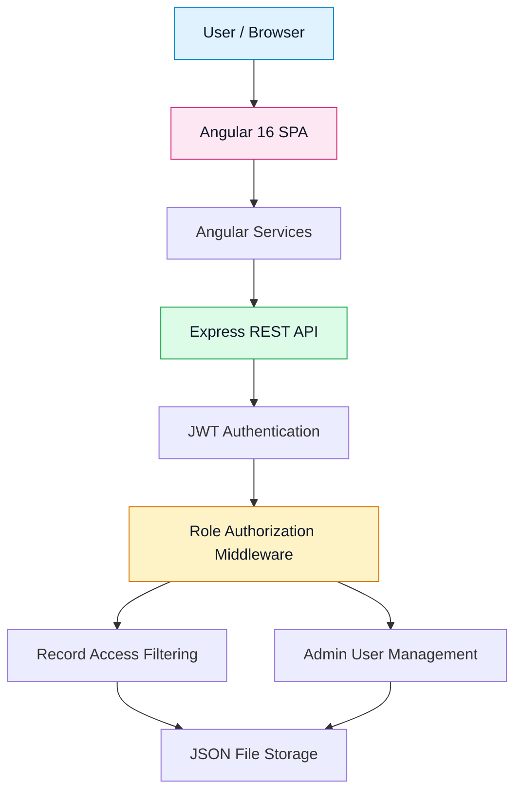

🚀 **Live Demo:** https://accessflow-frontend-ten.vercel.app/login

---

# 🔐 AccessFlow — Role-Based Access Management System

---

## 🌍 Live Deployment

**AccessFlow is deployed using Vercel and Render.**

| Component | Platform | Description                               |
| --------- | -------- | ----------------------------------------- |
| Frontend  | Vercel   | Hosts the Angular single-page application |
| Backend   | Render   | Runs the Express and TypeScript REST API  |

### 🚀 Try AccessFlow

[**👉 Click here to open the live application**](https://accessflow-frontend-ten.vercel.app/login)

Sign in with either demo account below to explore the application's role-based features.

> Note: The frontend is publicly accessible at the link above. Backend functionality depends on the Render service being available and correctly configured.

---

## ✨ About AccessFlow

**AccessFlow** is a full-stack web application that demonstrates how authentication, authorization, and role-based access control work together in a modern web application.

The application provides a centralized interface where users can sign in, access permitted records, and perform actions based on their assigned roles. Administrators receive additional user-management capabilities, while general users have more restricted access.

The project combines an Angular frontend with a Node.js and Express backend, using JSON Web Tokens (JWT) for authentication and middleware to enforce API permissions.

> 💡 **Core principle:** Every user should have access to the resources and actions they are authorized to use — nothing more, nothing less.

## 🚀 Key Features

## 🎭 User Roles and Permissions

| Feature                         | 👑 Administrator | 👤 General User |
| ------------------------------- | ---------------- | --------------- |
| Sign in                         | ✅                | ✅               |
| View own profile                | ✅                | ✅               |
| Access permitted records        | ✅                | ✅               |
| View and manage users           | ✅                | ❌               |
| Create user accounts            | ✅                | ❌               |
| Activate/deactivate accounts    | ✅                | ❌               |
| Delete user accounts            | ✅                | ❌               |
| Access administrator-only pages | ✅                | ❌               |

*Permissions should be verified against the actual backend implementation. Frontend route guards alone are not a security boundary.*

## 🧪 Demo Credentials

Use these accounts to test the application.

| Role          | User ID   | Password    |
| ------------- | --------- | ----------- |
| Administrator | `admin01` | `Admin@123` |
| General User  | `user01`  | `User@123`  |

**Suggested testing flow:**

1. Open the [AccessFlow login page](https://accessflow-frontend-ten.vercel.app/login).
2. Sign in as the administrator and explore the user-management functionality.
3. Sign out and sign in as the general user.
4. Compare the available pages, permissions, and record visibility.

⚠️ These are demonstration credentials, not production credentials. Replace or disable public demo accounts before using the application for real users.

## 🏗️ System Architecture

AccessFlow uses a client-server architecture that separates the frontend interface from backend authentication, authorization, and data operations.



### 🔄 Request Flow

1. **Authentication:** The user submits their credentials through the Angular login page.
2. **Token generation:** The backend verifies the credentials and issues a JWT after successful authentication.
3. **Request authorization:** Protected API endpoints validate the token and check permissions.
4. **Data filtering:** The API returns records according to the user's role and ownership.
5. **Administrative actions:** Authorized administrators can create, update the status of, and delete user accounts.

## 🧰 Technology Stack

| Technology      | Purpose                                    |
| --------------- | ------------------------------------------ |
| Angular 16      | Single-page application                    |
| TypeScript      | Type-safe frontend and backend development |
| RxJS            | Reactive programming                       |
| SCSS            | Frontend styling                           |
| Node.js         | Backend runtime                            |
| Express.js      | REST API and middleware                    |
| JSON Web Tokens | Authentication                             |
| bcryptjs        | Password hashing                           |
| JSON files      | Demonstration data storage                 |
| Vercel          | Frontend hosting                           |
| Render          | Backend hosting                            |

## 📡 API Reference

All API endpoints use the `/api` prefix.

| Method   | Endpoint                      | Access                             |
| -------- | ----------------------------- | ---------------------------------- |
| `POST`   | `/api/auth/login`             | Public                             |
| `GET`    | `/api/users/me`               | Authenticated users                |
| `GET`    | `/api/records`                | Authenticated users; role-filtered |
| `GET`    | `/api/admin/users`            | Administrator only                 |
| `POST`   | `/api/admin/users`            | Administrator only                 |
| `PATCH`  | `/api/admin/users/:id/status` | Administrator only                 |
| `DELETE` | `/api/admin/users/:id`        | Administrator only                 |

### Example: Login Request

```http
POST /api/auth/login
Content-Type: application/json

```

```json
{
  "userId": "admin01",
  "password": "Admin@123"
}

```

A successful response should contain the authentication token and relevant user information according to the backend implementation.

For authenticated endpoints, include the token in the request header:

```http
Authorization: Bearer <your-jwt-token>

```

## 💻 Getting Started

Follow these steps to run AccessFlow locally.

### Prerequisites

Install the following tools:

- [Node.js and npm](https://nodejs.org/)
- [Git](https://git-scm.com/)
- [Angular CLI](https://angular.dev/tools/cli) — optional if the project's npm scripts handle Angular CLI commands

### 1. Clone the Repository

```bash
git clone https://github.com/Racheljyothigundi/SPA-Application.git
cd SPA-Application

```

Replace the repository URL if your GitHub repository uses a different name.

### 2. Set Up the Backend

Open a terminal in the repository root and run:

```bash
cd backend
npm install

```

Create a `.env` file inside the `backend` directory:

```env
PORT=3000
JWT_SECRET=replace-with-a-long-random-secret
CLIENT_URL=http://localhost:4200

```

Start the backend development server:

```bash
npm run dev

```

The API should be available at `http://localhost:3000`, provided the default port is available.

### 3. Set Up the Frontend

Open a **second terminal** in the repository root:

```bash
cd frontend
npm install
npm start

```

Open the application in your browser:

[**http://localhost:4200**](http://localhost:4200/)

Ensure the frontend API service URLs point to the correct backend.

## ☁️ Deployment Guide

### Backend Deployment — Render

1. Connect the GitHub repository to Render.
2. Configure the backend service using `render.yaml`, if applicable to your setup.
3. Set `JWT_SECRET` to a strong, unique secret.
4. Set `CLIENT_URL` to the deployed frontend origin, for example `https://your-app.vercel.app`.
5. Ensure the backend listens on Render's assigned `PORT` and binds to `0.0.0.0`.
6. Deploy and verify the API.

### Frontend Deployment — Vercel

1. Import the GitHub repository into Vercel.
2. Set the project root directory to `frontend`.
3. Set the build command to `npm run build`.
4. Set the output directory to `dist/accessflow-frontend`.
5. Update frontend service URLs to point to the deployed Render API.
6. Redeploy and test both user roles.

**Important deployment settings:**

- `CLIENT_URL` should contain only the frontend origin — no `/login` path or trailing slash.
- The frontend must call the deployed backend URL rather than `localhost`.
- Never commit secrets or production credentials to GitHub.
- Verify that the backend CORS configuration permits the deployed frontend origin.

## 📁 Project Structure

```text
AccessFlow/
├── backend/
│   ├── src/
│   │   ├── data/           # Demo users and records
│   │   ├── middleware/     # Authentication and authorization
│   │   └── server.ts       # Express API entry point
│   └── package.json
│
├── frontend/
│   ├── src/
│   │   └── app/
│   │       ├── core/
│   │       │   └── services/  # API communication
│   │       └──              # Pages, guards, and models
│   ├── angular.json
│   └── package.json
│
├── render.yaml
└── README.md

```

## 🔒 Security and Limitations

AccessFlow is an educational demonstration of authentication and authorization patterns, not a production-ready identity management platform.

- Store secrets in environment variables and exclude `.env` files from version control.
- Use a strong, unique JWT secret and configure appropriate token expiration.
- Validate user input on the backend.
- Enforce permissions on protected API endpoints rather than relying exclusively on frontend guards.
- Hash passwords securely and never expose password hashes or sensitive account information.
- Add rate limiting, audit logging, and appropriate error handling.
- Use a persistent database for applications requiring reliable production storage.
- Review token storage, logout behavior, and token revocation before production use.

**Data persistence:** Users and records are stored in JSON files under `backend/src/data/`. This is convenient for a demo but is not suitable for reliable concurrent writes, multiple backend instances, or production-grade persistence.

## 🎯 Learning Outcomes

Through AccessFlow, I explored practical full-stack development concepts, including:

- Building an Angular single-page application.
- Designing and integrating REST APIs.
- Understanding authentication versus authorization.
- Implementing JWT-based authentication.
- Applying role-based access control.
- Using backend middleware to protect resources.
- Managing user permissions and record ownership.
- Deploying a frontend on Vercel and a backend on Render.
- Configuring environment variables and troubleshooting deployment issues.

## 🔮 Future Enhancements

-  Integrate PostgreSQL or MongoDB for persistent data storage.
-  Add refresh tokens and session revocation.
-  Implement password reset and account recovery.
-  Add automated unit and integration tests.
-  Introduce audit logs for administrative actions.
-  Add pagination, search, and filtering to user management.
-  Containerize the application with Docker.
-  Set up CI/CD using GitHub Actions.

## 👩‍💻 Author

**Rachel Jyothi Gundi**

B.Tech — Computer Science Engineering, Artificial Intelligence

Interested in software engineering, full-stack development, and AI-powered applications.

- **GitHub:** [@Racheljyothigundi](https://github.com/Racheljyothigundi)
- **LinkedIn:** [Rachel Jyothi Gundi](https://www.linkedin.com/in/rachel-jyothi-gundi-b03857322/)

---
